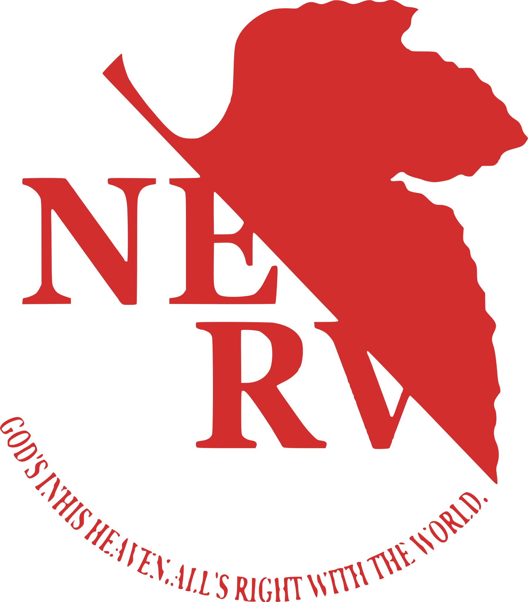

<div align="center">



# EVA Codex Nexus

**选择你的驾驶员，给原生 Codex 换一层 EVA 外壳。**

为**官方 Codex 桌面客户端**打造的 EVA 双角色皮肤，不是另做一个 Codex 工作台。<br />
明日香的红与黑，绫波丽的白与蓝；侧栏、项目、会话、输入框、审批与快捷键仍保持 Codex 原生。

[](https://github.com/HamizDev/eva-codex-nexus/tree/v0.4.1) [](LICENSE) [](#环境要求)

[**下载最新版本**](https://github.com/HamizDev/eva-codex-nexus/archive/refs/tags/v0.4.1.zip) · [使用流程](#使用流程) · [启动动画](#dsh-启动动画) · [更新日志](CHANGELOG.md) · [问题反馈](https://github.com/HamizDev/eva-codex-nexus/issues)

`eva-codex-nexus` · 当前版本 **v0.4.1（开发预览）**

</div>

> 非官方项目，与 OpenAI、Studio Khara、Gainax 及相关权利方均无关联。

从 v0.1.0 开始，默认入口启动的是**你电脑上已安装的官方 Codex**。侧栏、项目、会话、输入框、审批、菜单和快捷键仍然是 Codex 原生的，只额外叠加 EVA 的配色、线框和装饰层。v0.2.0 增加了无控制台启动、官方 Codex 图标的桌面快捷方式，以及可选的 DSH 启动动画本地资源包；v0.2.1 修复了 Windows PowerShell 5.1 下 CDP 目标列表误判、导致启动器拒绝注入的问题；v0.2.2 补齐了侧栏悬浮说明、改动汇总卡片、文件变更提示、用户气泡和发送按钮的面板配色；v0.3.0 增加应用内明日香/绫波丽切换、排队消息导轨适配，并完成真实窗口缩放验证；v0.3.1 修复用户消息气泡对比度，适配内置浏览器的标签、导航、地址栏、导入横幅和工具卡片，并在浏览器打开时自动收起驾驶员切换条；v0.3.2 适配右上角摘要面板的标题、分组线、文件行、缩略图和操作状态；v0.4.0 把 DSH 的角色立绘、选择语音、欢迎语音、审核/完成提醒和打字音接入本地媒体包，新增两类自动提醒开关、`表示設定` 面板、立绘透明度、主题内切换与完整媒体开关；v0.4.1 增加首次启动的驾驶员选择/拖放、修复启动层注入时机与完成音误播，并移除旧独立工作台和相关依赖。

## 入口

| 入口 | 行为 |
| --- | --- |
| 桌面 `EVA Codex` 快捷方式 | **推荐入口**：无控制台、官方 Codex 图标，官方 Codex + EVA 皮肤 |
| `Start-EVA.cmd` | 兼容入口：通过隐藏的 `Start-EVA.vbs` 启动；命令行窗口只短暂出现 |
| `Start-EVA.cmd rei` | 官方 Codex + 00 绫波丽皮肤 |
| `Start-EVA.cmd asuka` | 官方 Codex + 02 明日香皮肤 |
| 应用内右侧 `設 / SETTINGS` | 打开 `表示設定`：切换 02 明日香 / 00 绫波丽、开关动画/语音/打字音与审核/完成自动提醒、试听五类语音、调整立绘透明度；选择会持久化 |
| `Start-EVA-Rei.cmd` | 双击切换到 00 绫波丽皮肤 |
| `Restore-EVA.cmd` | 移除当前皮肤，不关闭 Codex；官方文件不被修改 |
| `Install-EVA-DesktopShortcut.cmd` | 重新创建桌面快捷方式；图标取自官方 Codex 客户端 |
| `Import-DSH-Boot.cmd` | 从本机 DSH 主题仓库导入启动动画素材；媒体只留在本机 |

Windows 的 `.cmd` 文件不能可靠地自定义图标。本项目的做法是创建一个目标为 `wscript.exe` 的 `.lnk` 快捷方式：它直接调用隐藏的 `Start-EVA.vbs`，图标使用 `ChatGPT.exe,0`，因此桌面上看到的是官方 Codex 图标，启动时也不会留下 CMD/PowerShell 黑框。

首次使用默认入口时，如果 Codex 已经打开，脚本会提示**重启一次**，因为当前窗口没有开启本地调试端口。重启后会继续使用官方 Codex 的账号和会话数据；本工具不读取、不修改 `auth.json`、API Key、Base URL 或模型配置。

每次启动一个新的 Codex 进程时，会先播放一次启动层。导入 DSH 资源包后使用 `nerv-boot.gif → NERV 警报 → 选择驾驶员 → 插入栓/同步` 序列：可把明日香或绫波丽的头像拖到左侧插入栓，也可直接点击角色卡或用键盘选择；选择后播放对应驾驶员的应答音和本机启动语音。没有资源包时回退到 v0.1.1 的抽象线框启动层。`Esc`、`Space` 或“跳过 / ESC”按钮可跳过，刷新 renderer、应用内切换主题或重新附加注入器不会重播；系统开启“减少动态效果”时直接跳过。`表示設定 → 开机动画` 是整套启动流程的总开关，关闭后不会出现驾驶员选择页；启动语音、选择应答、欢迎语音和打字音可继续单独关闭。审核自动语音与完成自动语音默认关闭；手动打开后，待审批出现时播放一次审核提醒，主任务从运行中转为完成时播放一次完成提醒，刷新页面、打开旧会话或浏览历史消息不会误播。

## DSH 启动动画

仓库不会提交 DSH 的 GIF、角色头像、立绘、语音或音乐。需要 DSH 启动动画与角色媒体时，在本机已有 DSH 主题仓库的前提下运行：

```powershell
Import-DSH-Boot.cmd "D:\path\to\dsh-plugin-eva-theme"
```

导入器会校验 DSH `assets/manifest.json` 中的字节数和 SHA-256，再把 18 个本地素材（启动 GIF、警报/插入栓、两张头像、两张立绘、五类语音和打字音）复制到 `%LOCALAPPDATA%\EVACodexSkin\dsh-boot`，合计 5,170,918 字节。注入器启动时自动读取该目录；校验失败时不会使用损坏或篡改的包。完整边界和目录结构见 [DSH-BOOT.md](DSH-BOOT.md)。

## 使用流程

默认入口的日常流程和官方 Codex 一致：

- 用官方侧栏切换项目、置顶和最近会话；
- 新建聊天、选择模型、附加文件、发送任务；
- 使用原生审批、停止、回滚和设置；
- 使用原生菜单、搜索、快捷键和窗口行为；
- 关闭窗口即退出本次皮肤会话。

皮肤不是独立客户端，也不是网页套壳。它向官方 renderer 注入配色 CSS、常驻的 `pointer-events: none` 装饰层，以及启动时显示、可跳过且可关闭的启动层；启动层结束后会完全释放输入。应用内切换驾驶员只更新配色、立绘和可选应答音，不会重新播放启动动画。它不会替换 React 组件，不会修改 `app.asar`，不会改签名，也不会绕过登录或订阅配额。

常驻装饰层本身仍为 `pointer-events: none`；右侧设置按钮和 `表示設定` 面板是唯一例外，只有这些控件接收点击，并使用 `-webkit-app-region: no-drag`，不会拖拽或遮挡原生窗口控制。窗口移动或缩放后，覆盖层跟随当前视口重新铺满；窄窗口下设置按钮压缩为 `設`，设置面板改为底部面板。

## 环境要求

- Windows 10/11；
- 官方 Codex 桌面客户端（Microsoft Store 安装，Appx）；
- Node.js 22 或更高版本（注入器使用内置 WebSocket）；
- Windows PowerShell 5.1 或 PowerShell 7；
- 无需安装浏览器插件，也无需修改系统权限。

## 工作方式

1. 通过 `Get-AppxPackage OpenAI.Codex` 找到已签名、已注册的官方客户端；
2. 以 `--remote-debugging-address=127.0.0.1 --remote-debugging-port=9345` 启动一个受控实例；
3. 使用独立的 Chromium 配置目录 `%LOCALAPPDATA%\EVACodexSkin\cdp-profile`，避免污染官方默认配置；
4. 只连接 URL 为 `app://-/index.html` 的页面，拒绝 `avatar-overlay` 宠物层和非回环 WebSocket；
5. 从官方 Codex 主进程的启动时间生成一次性启动指纹；若本机存在已校验的 DSH 启动包，则注入 `assets/dsh-boot.css` 和带驾驶员选择/拖放的 DSH 序列，否则注入抽象启动层；
6. 注入 `codex-skin/assets/eva-skin.css`、`skin-ui.js` 和常驻装饰层；
7. 读取本地媒体包，提供驾驶员切换、立绘、设置面板、语音试听、开机欢迎语音和可选的审核/完成自动提醒；
8. 监视页面重载、应用内主题切换及原生审批/运行状态，自动重新应用并做事件去重；同一 Codex 进程不重播启动层；
9. `Restore-EVA.cmd` 删除样式、启动层、设置 UI、装饰节点和注入器进程。

实现参考了现有 Codex 换肤项目的回环 CDP、目标校验、`Page.addScriptToEvaluateOnNewDocument` 和 watcher 架构；没有把它们的角色图片、音轨或主题素材打包进本仓库。选择器和适配边界记录在 `codex-skin/selectors.json`。

## 安全边界

- CDP 只绑定 `127.0.0.1`，但调试通道本身没有额外认证。皮肤运行期间，本机其他程序理论上可以连接该端口。
- 不要把端口转发到局域网或公网；不要在运行皮肤时执行来路不明的本机程序。
- 退出皮肤：运行 `Restore-EVA.cmd`，或直接关闭该 Codex 窗口。
- 不修改 WindowsApps、`app.asar`、官方签名、账号令牌、网络代理或 Codex 配置。
- 如果官方客户端更新导致选择器失效，皮肤会降级为只注入颜色层；不会接管输入和审批。

## 验证状态

已在 `OpenAI.Codex 26.1106.6628.0`、Chromium `157.0.8103.51` 的真实 `app://-/index.html` renderer 上做过受控实例冒烟：

- 02 明日香与 00 绫波丽两套皮肤均能注入；
- DSH GIF、NERV 警报、驾驶员选择页、拖放插入栓、驾驶员头像和同步进度均正常渲染；启动语音在本机受控实例中可自动播放；
- 在启动页可点击角色卡完成选择，也可把角色卡拖入插入栓；选择后主题、头像、单位编号和语音时长同步更新；
- 刷新页面不重播启动层，`Esc` 可跳过，完整序列结束后自动清理，“减少动态效果”下不显示；
- `表示設定 → 开机动画` 关闭后，下一次启动不显示选择页且不播放启动序列；应用内切换驾驶员不会触发启动页；
- 侧栏、主区、输入框、原生按钮仍可交互；
- 皮肤层 `pointer-events: none`；
- 应用内点击 `02 ASUKA` / `00 REI` 可即时换肤，`localStorage` 与 `driver.txt` 同步；
- `表示設定` 面板在真实 renderer 中打开、关闭、切换驾驶员和持久化验证通过；1440×1000 下完整内容无需滚动，1280×830 下无横向溢出；
- 内置浏览器打开时保留 `設` 设置入口，并把按钮下移到浏览器侧栏之外；
- 本地媒体包包含 18 个素材，立绘、五类语音试听和输入打字音均能读取；
- 审核/完成自动语音状态机在隔离 DOM 样例中通过：打开历史审批不误播，新审批只播一次，“运行中 → 新完成回复”只播一次，两类事件使用不同音源；
- 真实窗口缩放到 `1000×700`、`760×600` 后，覆盖层仍与视口等大，设置按钮保持在窗口内且无横向溢出；
- 真实排队消息导轨使用 EVA 面板色和强调线，测试消息已删除；
- 文件变更胶囊为深色面板、EVA 边框与左侧强调线；
- `--remove` 后样式、覆盖层和 dataset 标记均消失；
- `--verify` 能识别注入前后的状态。

桌面快捷方式已在本机创建并验证：目标为 `wscript.exe`，参数指向 `Start-EVA.vbs`，图标为官方 `ChatGPT.exe,0`，工作目录为仓库根目录。没有在本次会话中强行重启你正在使用的 Codex 窗口；隐藏入口的完整“关闭当前窗口→Appx 激活→重新打开”路径仍需要你在方便时执行一次。如果 Appx 激活丢弃 CDP 参数，脚本会自动回退到直接启动已签名的 Store 可执行文件。

## 开发与发布检查

```powershell
npm test
npm run manifest
npm run verify:public
```

只跑皮肤测试：

```powershell
npm run test:skin
```

手动检查注入状态：

```powershell
node codex-skin\injector.mjs --verify --port 9345
node codex-skin\injector.mjs --remove --port 9345
```

## 目录

```text
codex-skin/
  Start-EVA.ps1          # 官方 Codex 启动/重启/注入
  Import-DSH-Boot.ps1    # 校验并导入本机 DSH 启动素材
  Restore-EVA.ps1        # 移除皮肤
  injector.mjs           # CDP 目标校验、注入、watcher、verify/remove
  selectors.json         # 稳定 DOM 锚点合同
  assets/
    eva-skin.css         # 两套配色和装饰层
    boot.css             # 无 DSH 包时的抽象启动层
    dsh-boot.css         # DSH 风格启动层的自有 CSS
    skin-ui.js           # 表示設定、立绘、媒体开关、试听与自动提醒
    asuka-mark.svg
    rei-mark.svg
    linework.svg
  tests/
```

## 已知限制

- Codex 更新可能改变 DOM 和 CSS Module 前缀；届时需要先运行 `--verify`，再更新 `selectors.json` 和皮肤 CSS。
- 独立配置目录首次进入时可能需要登录一次；不同环境和版本不保证一定自动复用已有会话。
- 没有实现自动更新、托盘控制、安装器或 macOS/Linux 版本。
- 皮肤不改变模型、账户、计费、配额或任务执行逻辑。
- 公开仓库不包含 DSH 的角色图、GIF、语音或音乐；未导入本地 DSH 资源包时，启动层回退为抽象数字、线框和扫描动效。
- DSH 启动包不导入 9.4 MB 背景音乐；其再分发条件和体积均与本项目启动器不同。启动语音只在本机资源包内使用。
- 启动层复用了 DSH 仓库的 GIF、警报、插入栓、头像和语音，并实现了驾驶员点击/拖放选择；仍不等同于 DSH 插件的逐字引导与机械舱门动画。
- 审核自动语音与完成自动语音默认关闭，需在 `表示設定` 中手动开启；它们依赖 Codex renderer 的当前 DOM 锚点，Store 更新后若状态标记消失会自动降级为不播放，而不会监听任意页面变化。

## 素材与许可

代码采用 MIT，版权署名为 `HamizDev`。公开包包含抽象线框、编号和调色板、用于读取本地资源包的导入器与自有 CSS，以及 README 顶部使用的 NERV 同人标识；不包含 DSH 角色 PNG、GIF、语音、音乐或动画片段。该 NERV 标识仅用于同人主题展示，不属于 MIT 覆盖范围。

MIT 不覆盖 EVA 角色形象、NERV/EVA 商标、原作音乐或语音。当前仓库只面向官方 Codex Desktop 换肤，不包含旧 Web 工作台、Codex CLI bridge、终端/Git/插件面板或相关依赖。素材边界见 `ASSETS.md`、`ASSET-TODO.md` 和 `codex-skin/assets/README.md`；来源与第三方许可见 `PROVENANCE.md`、`THIRD_PARTY_NOTICES.md`。
